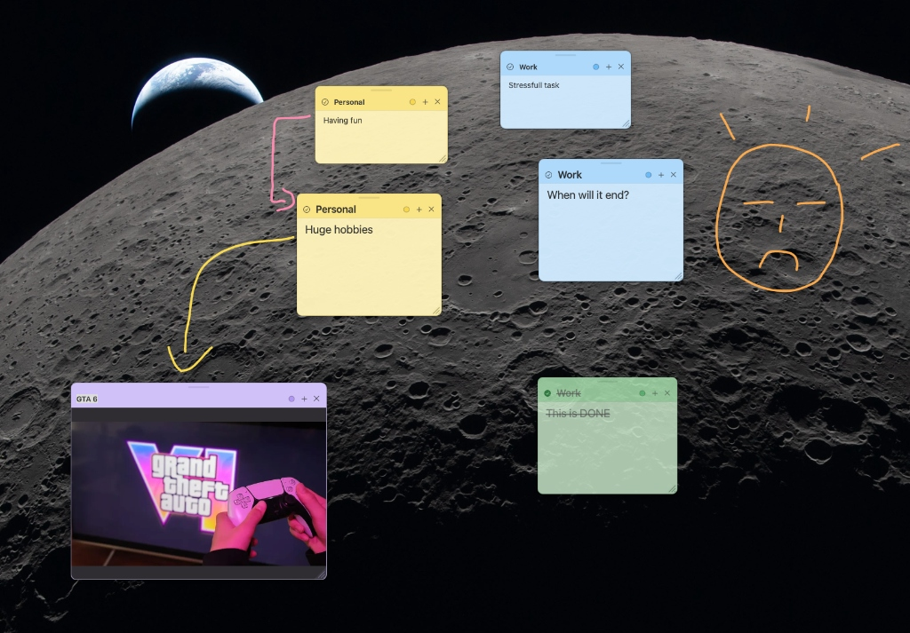

# StickitToTheMax

Lightweight native macOS app for pinning color-coded to-do stickies, pictures, and freehand drawings directly to your desktop wallpaper.

🌐 **Website & Interactive Preview:** [flup-repo.github.io/StickitToTheMax](https://flup-repo.github.io/StickitToTheMax/)



## Why Swift + AppKit?

- **Minimal memory & CPU**: Pure native AppKit with zero third-party dependencies, no Electron/WebView overhead (~15–25 MB RAM, ~0% idle CPU).
- **True wallpaper pinning**: Uses `CGWindowLevelForKey(.desktopIconWindow) + 1` with `.canJoinAllSpaces`, `.stationary`, and `.ignoresCycle` so stickies and drawings stay strictly beneath normal application windows, remain visible across Spaces, and stay glued to the wallpaper during Mission Control / **Show Desktop**.

## Features

- **Wallpaper-only stickies**: Always stay behind open app windows; visible whenever you view your desktop.
- **Top title & color coding**: Inline editable header with 6 sticky colors (Yellow, Blue, Green, Pink, Purple, Orange) and quick category presets from the menu bar.
- **Mark as done**: Click the checkmark button (`✓`) in a sticky's header to cross out the title and text with strikethrough and subtle dimming, or clear all done stickies in one click.
- **Draw on wallpaper (`⌥⇧D`)**:
  - Toggle Drawing Mode from anywhere with **Option + Shift + D** (or via the menu bar).
  - Smooth freehand **Pen (`P`)** with 8 colors and resizable tip (`2–24 pt`, slider or `[` / `]`).
  - **Stroke Eraser (`E`)** to swipe away individual lines, plus **Undo (`⌘Z`)** and **Clear All**.
  - Drawings stay pinned on your wallpaper and pass clicks straight through once you exit Drawing Mode (`Esc` or **Done**).
- **Picture stickies**:
  - Pin any image from disk (**New Picture Sticky…** / `⌘I`) or straight from your clipboard (**Paste Picture Sticky**).
  - Resizes smoothly from any corner while preserving aspect ratio (down to `190×140` or up to `1200×1200`), with editable title, color header, and automatic local image storage.
- **Multi-select & group actions**:
  - Drag a selection box on the wallpaper or `⌘+Click` stickies to move, resize, and adjust font sizes (`⌘+`, `⌘-`, `⌘0`) together.
- **Launch at Login**: Toggle **Launch at Login** directly from the menu bar (powered by native `SMAppService`).
- **Automatic persistence**: Stickies, drawings, and imported pictures are saved to `~/Library/Application Support/StickitToTheMax/`.

## Shortcuts

| Shortcut | Action |
| --- | --- |
| `⌥⇧D` | Toggle Drawing Mode (global) |
| `P` / `E` | Switch between Pen and Stroke Eraser (in Drawing Mode) |
| `[` / `]` | Decrease / increase pen or eraser size (in Drawing Mode) |
| `⌘Z` | Undo last draw or erase (in Drawing Mode) |
| `⌘+` / `⌘-` / `⌘0` | Increase / decrease / reset sticky font size |
| `⌘+Click` or Wallpaper Drag | Multi-select stickies |
| `Esc` | Exit Drawing Mode or clear selection |

## Build & Run

```bash
# Run unit tests
swift test

# Build release .app bundle
chmod +x scripts/bundle.sh
./scripts/bundle.sh

# Launch the app
open build/StickitToTheMax.app
```

To start automatically at login, copy `build/StickitToTheMax.app` into `/Applications` and enable **Launch at Login** from the menu bar icon.
